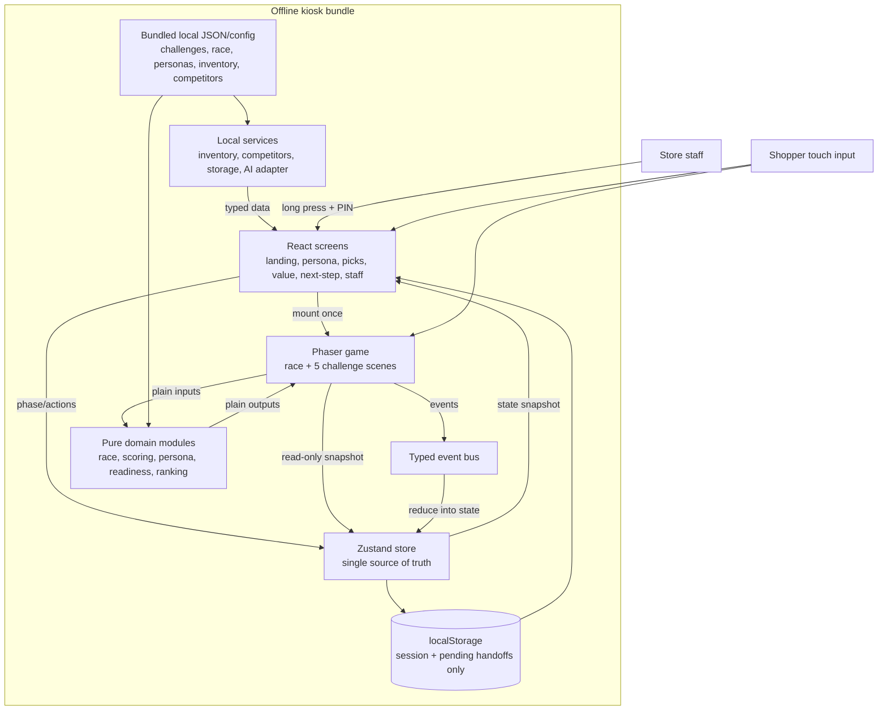
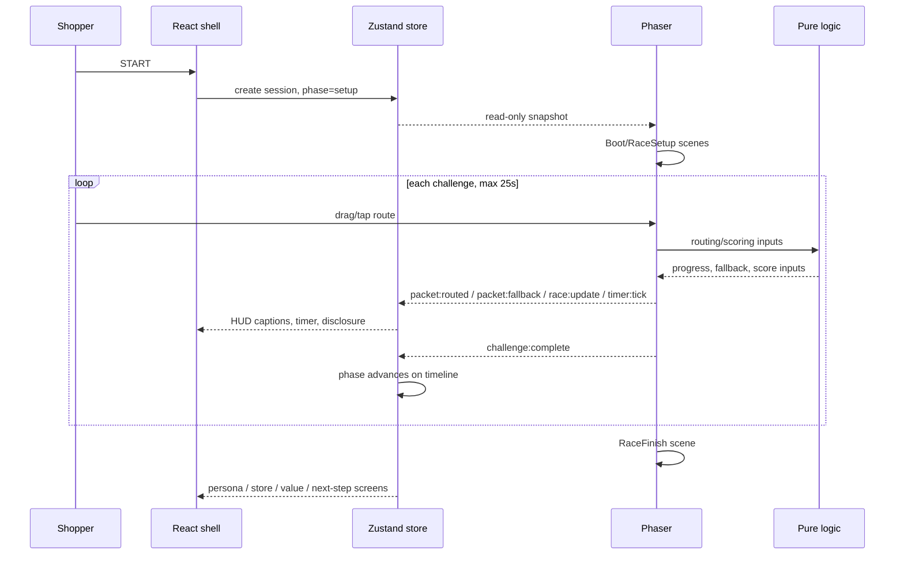
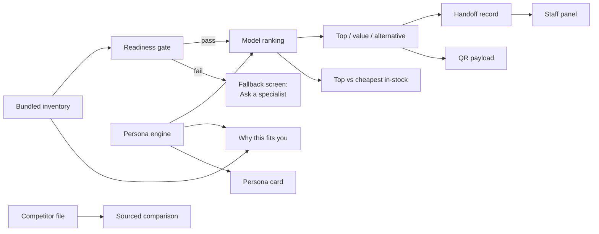

# Architecture — AI PC Showdown (v3)

Status: Phases 1–4 implemented. Pilot data, LIVE mode and kiosk hardening remain planned.

This document derives the system architecture from `CLAUDE.md` v3. It describes boundaries, contracts, data flow, risks and open decisions. Where the spec is ambiguous, the ambiguity is recorded instead of silently resolved.

---

## 1. System Context

The product is a single offline kiosk bundle. There is no backend and no runtime network call. Everything needed for a session is bundled at build time: app code, challenge config, pre-generated media, self-hosted fonts, store inventory and competitor reference data.

### Hard boundary

- React owns all non-gameplay screens, the staff panel, idle/reset logic and the store readiness gate presentation.
- The staff panel is an app-shell overlay, not a route, so opening it never unmounts an active Phaser challenge.
- Phaser owns race animation, five challenge scenes, timers, packet movement, particles and in-game feedback.
- Phaser scenes never import React components. Phaser reads state only through a read-only Zustand snapshot and communicates through the event bus.
- Scoring, routing, persona, readiness and ranking functions are pure, UI-free and unit tested. Presentation never computes those results.

---

## 2. Layer Map

| Layer | Location from spec | Responsibility | Must not do |
|---|---|---|---|
| App shell | `src/app/` | Hash routing, providers, phase-driven screen selection, single Phaser mount | Own race/scoring rules |
| React screens | `src/features/`, `src/components/` | Landing, store picks, value/fit, next-step, staff panel, checklist | Import Phaser scenes into screen logic |
| Shared state | `src/store/` | `GameState`, actions, phase transitions, event reduction | Contain derived product/scoring logic |
| Game engine | `src/game/scenes/` | Boot, setup, five challenges, race finish, timers, tweens, particles | Write React state directly |
| Game contracts | `src/game/events/` | Typed event names and payloads shared by Phaser and React | Import React or Phaser types into pure logic |
| Pure game logic | `src/game/race/`, `src/game/scoring/` | Deterministic routing, fallback, progress, scores | Touch DOM, timers, network or UI |
| Recommendation logic | `src/features/recommendations/`, `src/features/store-readiness/`, `src/features/value-compare/`, `src/features/fit-panel/` | Persona, ranking, gate, comparison rows, fit proof rows | Import React/Phaser |
| Services | `src/services/` | Inventory, competitors, storage, AI adapter | Fetch over network |
| Config/data | `src/data/`, `stores/` | Bundled local JSON and mode config | Contain unverified specs/prices |
| Styles/assets | `src/styles/`, `public/` | Tokens, self-hosted fonts, pre-generated images | Load external URLs |
| Docs | `docs/` | Architecture, game design, implementation plan and later phase docs | Invent claims or numbers |

---

## 3. State Model

The Zustand store is the single source of truth. The spec-defined `GameState` fields remain authoritative:

| Field | Purpose | Main writer | Main consumer |
|---|---|---|---|
| `sessionId` | Random, local-only identifier; never sent anywhere | React on START | Staff/debug only; not in QR/card |
| `storeId` | Selects bundled `stores/{storeId}/inventory.json` | Boot/config | Inventory service, staff panel |
| `mode` | `DEMO` or `LIVE` from local config | Boot/config | AI adapter, labels |
| `phase` | Screen/phase selector | React + event reduction | App shell |
| `currentChallenge` | 1..5 | Phaser events via store | React HUD, scenes |
| `startedAt`, `completedAt` | Timeline measurement | React | Results, timing tests |
| `challengeScores` | Per-challenge score, max 200 each | `challenge:complete` | Results screen |
| `challengeStatus` | pending/completed/skipped/timed-out | `challenge:complete` | Results, timing |
| `challengeSubscores` | Optional routing/meter sub-signals, e.g. `gamingRouting` | `challenge:complete` | Persona engine |
| `remainingMs` | Current 25-second challenge countdown | `timer:tick` | React HUD |
| `caption` | Latest transient HUD caption | `game:caption` | React HUD |
| `packetRoutes` | Final route and fallback flag per packet | `packet:routed`, `packet:fallback` | Race, scoring, staff/debug |
| `race` | Left/right progress | `race:update` | Race HUD, finish |
| `persona` | Result of weighted persona engine | Persona engine | Store ranking, value fit |
| `recommendedModelCodes` | Top/value/alternative codes | Ranking + gate | Store picks, QR |
| `storeReady` | Readiness gate result | Gate logic | Staff panel, store screen |
| `handoffPending` | Whether a specialist handoff exists | Handoff service | Next-step, staff panel |

### Derived data

Derived values are computed by pure functions from plain inputs, then written back as plain results:

- Race progress and fallback delay.
- Challenge score and achievement.
- Persona, priorities and strongest category.
- Readiness gate pass/fail.
- Ranked models, top/value/alternative selection, cheapest in-stock model.
- Fit-panel rows and price-versus-value rows.

### State rules

- Restart resets all session fields except pending handoffs.
- `sessionId` is not included in the QR payload or persona card.
- During a challenge, idle reset is disabled; the 25-second cap is the only automatic exit.
- After the guided session, the ending remains available for handoff/QR until the applicable idle rule fires.

---

## 4. Event Bus Contract

Phaser emits; React/Zustand reduce. Event names below are the ones named in the spec. Payload shapes are proposed contracts, not implementation code.

| Event | Implemented payload | Consumer effect |
|---|---|---|
| `packet:routed` | `challengeId`, `packetId`, `routedTo: CPU\|GPU\|NPU`, `fellBack` | Records route; requests race progress from pure logic |
| `packet:fallback` | `challengeId`, `packetId`, `from: NPU`, `to: CPU\|GPU`, `captionKey` | Records fallback once; shows configured caption |
| `race:update` | `leftProgress`, `rightProgress`, `segmentId` | Updates `race` state and HUD |
| `timer:tick` | `challengeId`, `remainingMs` | Updates HUD timer only; must not recreate scenes |
| `challenge:progress` | `challengeId`, `score` | Updates best partial score for timeout |
| `challenge:complete` | `challengeId`, `status`, `score`, `durationMs`, optional `subscores` | Updates score/status/subscores |
| `challenge:skip` | `challengeId` | Scores 0 and ties both lanes |
| `game:show` | `phase`, `challengeIndex` | Requests a Phaser segment switch |
| `game:caption` | `text`, `durationMs` | Shows a transient HUD caption |

### Lifecycle rules

- One Phaser game instance per mounted session; no duplicate instances after restart.
- All scene listeners and timers are removed on scene shutdown.
- Event subscriptions are registered once at the React/Phaser bridge and unregistered on unmount.
- Scene transition authority follows the Section 4 timeline, not independent scene timers.

---

## 5. Pure Domain Modules

These modules are the testable core. They accept plain objects and return plain objects.

| Module | Inputs | Outputs | Notes |
|---|---|---|---|
| Race/routing | Effective packet, chosen engine, race config | Lane progress delta, fallback destination, delay | Deterministic; no wall-clock reads inside |
| Scoring | Mechanic actions, route outcomes, elapsed time, challenge config | Score clamped to 0..200, status | Speed bonus only on correct answers |
| Persona engine | Category/subcategory scores | Persona, three priorities, note if skip-heavy | Weighted calculation always; no UI imports |
| Model ranking | In-stock models, persona, gate result | Top/value/alternative codes | Sparse/null-safe; no invented values |
| Readiness gate | Store `priceDate`, model `lastVerified`, `inStock` | Pass/fail with reasons for staff | Uses local kiosk date |
| Value compare | Top and cheapest in-stock models | Plain-language difference rows | No score, percentage or overall winner |
| Fit panel | Persona priorities, model fields, sources | Proof rows or `"Ask our team"` | Every verified row names its source |

---

## 6. Data and Config Contracts

All data is bundled. No runtime `fetch`, CDN font, remote image or external resource load is allowed.

| File | Role | Contract highlights |
|---|---|---|
| `src/data/challenges.json` | Challenge content and packet semantics | Scenario, objective, mechanic copy, educational message, packet `id`, `label`, `npuCompatible`, `gpuSuitable`, `npuBenefit`, `fallbackEngine`, `illustrativeRoutingWeight` |
| `src/data/race.json` | Race tuning | Fallback delays, lane/particle constraints, weight/delay lookup keyed by packet id |
| `src/data/personas.json` | Persona definitions | Persona ids, priorities, weights, tie-break order |
| `src/data/race.json` + `challenges.json` | Effective packet assembly | See Open Decisions: the spec places `illustrativeRoutingWeight` in both locations |
| `stores/{storeId}/inventory.json` | Staff-maintained store inventory | Exact schema in spec; null means not shown; `inStock:false` never recommended |
| `data/competitors.json` | Sourced competitor classes | AMD Ryzen AI, Qualcomm Snapdragon X, Apple M-series; each has NPU note, at least one strength, Intel strengths, `lastVerified`, sources |
| Local mode config | `DEMO`/`LIVE` selection | Set outside UI; path and schema to be fixed in Phase 0/1 |

### Validation requirements

- Config load fails loudly on missing packet fields, unknown engines, unknown benefit values or duplicate packet ids.
- Inventory loader validates `storeId`, `currency`, `priceDate`, model codes, `inStock` and null-able fields.
- Competitor loader fails if any class lacks a strength with a source.
- The offline build check ignores citation URLs inside JSON (`sourceUrls`, `sourceUrl`) but fails on runtime resource URLs in source code.

---

## 7. Runtime Flows

### 7.1 Guided session

### 7.2 Ending data flow

---

## 8. Offline, Privacy and Kiosk Architecture

### Offline build

- Vite emits a static bundle; `vite-plugin-pwa` precaches every route, image, audio file, animation and JSON file.
- Fonts are self-hosted Inter and Space Grotesk.
- Store inventory is included at build time; `storeId` selects the bundled file.
- A build check fails on runtime `fetch` or external resource URLs in source.
- Citation URLs in data files are allowed because they are displayed as sources, not requested.

### Kiosk runtime

- Static bundle served locally or opened from built `index`, then Chromium fullscreen kiosk with no browser UI.
- Auto-start on boot; restart on crash.
- Primary 1920 × 1080; must also work at 1366 × 768.
- Touch-only input; 64 px minimum touch targets; WCAG AA contrast.

### Privacy

- `localStorage` holds only current session state and pending handoffs.
- Handoff record contains store id, persona, viewed model code and timestamp only.
- Handoffs are removed on staff confirmation or after 24 hours, whichever is first.
- QR payload is `IPCS|STORE:{storeId}|P:{persona}|M:{modelCodes}` with no session id or shopper identifier.
- Persona card contains persona name, top priority, store name and QR; no name, photo, session id or timestamp.
- No cookies, analytics or person-linked identifiers.

### Idle/reset ambiguity

The spec gives 60 seconds for landing/ending idle reset and a separate 45-second ending results timeout. Architecture treats the more specific 45-second ending rule as authoritative and 60 seconds for landing, but this is recorded as an open decision in `IMPLEMENTATION_PLAN.md`.

---

## 9. Cross-Cutting Guardrails

| Guardrail | Architectural enforcement |
|---|---|
| Race is illustrative, not a benchmark | Pure config keys use `illustrativeRoutingWeight`; UI copy uses "routing" |
| Required disclosure | Rendered in race HUD and results screen from a single copy constant |
| No FPS, latency, speedup, battery-life figures or benchmark claims | Content review plus banned-string build check |
| NPU execution claim only with proof | DEMO default; LIVE adapter requires recorded execution-device report |
| Privacy is app/settings dependent | Required Privacy Shield result line; no "NPU guarantees privacy" copy |
| Gaming honesty | GPU is game engine; NPU only for supported effects packets |
| No invented product data | Unknown fields are null and display as "Not shown" / "Ask our team" |
| Competitors treated fairly | Every class has at least one sourced strength; no claimed lack of AI capability |
| Branding | Intel-inspired, not presented as official without authorisation |

---

## 10. Technical Risks

| ID | Risk | Impact | Mitigation | Phase |
|---|---|---|---|---|
| A1 | React/Phaser lifecycle mismatch: duplicate games, stale listeners, timers surviving scene exit | Broken sessions, wrong scores | Single mount, typed events, scene shutdown cleanup, event unsubscription tests | 2, 3 |
| A2 | 180 s budget lost to transitions, scene boot or animations | Guided session overruns | Timeline controller using absolute targets; auto-advance on cap/skip; 20 timed runs on target unit | 2, 3, 7 |
| A3 | Race/scoring/persona drift between UI and pure logic | Incorrect or non-deterministic results | Pure modules own all derivation; configuration loader merges data once; unit tests | 2, 3, 4 |
| A4 | Offline check misses external asset or JSON accidentally fetched | Kiosk fails without network | Build-time scanner, PWA precache audit, network-panel cold-boot test | 1, 7 |
| A5 | Verified inventory or competitor sources unavailable | Gate fails or recommendations blocked | Fail-safe fallback path; example inventory only; staff data collection before Phase 5 | 4, 5 |
| A6 | Clock/date errors on kiosk make readiness gate incorrectly fail | Store picks hidden despite valid stock | Staff panel shows gate reason; validate kiosk date at pilot; decision needed on trusted date source | 4, 7 |
| A7 | LIVE/NPU claims cannot be verified | Misleading privacy/performance claims | DEMO default; optional LIVE only with recorded execution device; failure falls back | 6 |
| A8 | Copy accidentally includes banned claims or "efficiency" race wording | Spec violation | Central copy constants and banned-string check; content review | 1, 3, 5 |
| A9 | Sparse/ambiguous product fields make ranking arbitrary | Unfair or invented recommendations | Null-safe comparator, deterministic tie-breaks, no numeric invention | 4 |
| A10 | Long-press staff panel conflicts with touch gameplay | Challenge input errors | Corner-only gesture with deliberate 3s hold; confirm whether active during challenges | 4, 7 |

---

## 11. Open Design Decisions

These need resolution before the corresponding implementation phase. Recommended defaults are documented in `IMPLEMENTATION_PLAN.md`. Phases 2–3 resolved the routing split, config ownership, skip/default-route and demo-asset decisions as implemented below.

| Decision | Why it matters |
|---|---|
| Is the ending idle timeout 45 s or 60 s? | Affects reset behavior and handoff availability |
| How is Stream Night split into gaming routing and multitasking routing for persona weights? | Section 8 needs two sub-signals but Section 7 stores one score per challenge |
| Is `priceDate` store-level or per model for the readiness gate? | Section 10 puts `priceDate` at store level; Section 9 says models have `lastVerified` and `priceDate` |
| Where do `illustrativeRoutingWeight` values live? | Section 5.1 puts them on packets; Section 16 puts them in `race.json` |
| Which packet defaults apply to skips and to Battery Escape `npuBenefit:"none"` packets? | Skips must be ties; Battery Escape needs explicit NPU compatibility for the "no change" caption |
| Where is the store-specific PIN/config stored and how is `storeId` selected on the unit? | Needed for staff panel and inventory selection |
| What exactly is the "staff-printable area" for the persona card? | Determines whether export is local image download, on-screen print view, or both |
| Is LIVE mode in scope for the pilot or is DEMO-only the release target? | Determines Phase 6 effort and target-unit verification work |
