# Game Design — AI PC Showdown (v3)

Status: Phase 2 race, all five Phase 3 challenges and the audited Phase 4 ending implemented; timing validation and pilot data remain.

This document turns `CLAUDE.md` v3 into an implementable game specification: timeline, core loop, challenge mechanics, scoring, persona, ending, copy guardrails and test scenarios. Ambiguities are recorded rather than silently resolved.

### Implementation status (Phases 2–4)

- Race, fallback, skip, timeout and the 180-second segment controller are implemented from `src/data/race.json`.
- All five challenges have pure scorers in `src/game/scoring/`, interactive Phaser scenes, 25-second caps and unit tests.
- Creator Mode uses four local demo SVGs in `public/images/` and is labelled "Demo content"; no live-inference claim is made.
- Stream Night emits `gamingRouting` and `multitaskingRouting` subscores and keeps the capped total score.
- Battery Escape uses config-only illustrative drain values, including `gpuSuitableDrain` and a no-change caption for `npuBenefit: "none"` routed to the NPU.
- The ending uses absolute session deadlines for persona, store picks, value/fit and next-step; direct ending-route access is guarded and idle reset clears session state.
- Touch targets and Phaser hit areas were enlarged for 1366 × 768 kiosk use, and Study Sprint uses nine concepts with two distractors.
- 51 unit tests, strict TypeScript, ESLint, offline source check and production build pass; on-unit timing and visual sign-off remain.

---

## 1. Player Journey

A shopper starts with no login or setup. The guided session is 180 seconds, then the ending stays open for handoff or QR actions until the idle rule applies.

```mermaid
flowchart LR
  L[Landing<br/>0s pre-session] --> S[Race setup<br/>0-5s]
  S --> C1[Study Sprint<br/>5-30s]
  C1 --> C2[Creator Mode<br/>30-55s]
  C2 --> C3[Privacy Shield<br/>55-80s]
  C3 --> C4[Stream Night<br/>80-105s]
  C4 --> C5[Battery Escape<br/>105-130s]
  C5 --> F[Race finish<br/>130-140s]
  F --> P[Persona reveal<br/>140-152s]
  P --> R[Store picks or fallback<br/>152-165s]
  R --> V[Value + fit<br/>165-175s]
  V --> N[Next-step bar<br/>175-180s+]
```

### Landing screen

- Must communicate the hook within 3 seconds.
- Key content: logo, two laptop silhouettes with pulsing lanes, headline `"YOUR NEXT LAPTOP NEEDS AN UPGRADE."`, subline `"5 challenges. 180 seconds. One smarter choice."`, one primary START action.
- Must not feel like an advertisement, spec sheet, quiz or chatbot.

---

## 2. Timeline

| Start (s) | End (s) | Duration | Screen | Required behavior |
|---:|---:|---:|---|---|
| 0 | 5 | 5 | Race setup | Two lanes appear with captions: "Your choices decide who wins." |
| 5 | 30 | 25 | Study Sprint | One packet routed; race HUD updates |
| 30 | 55 | 25 | Creator Mode | Packets routed |
| 55 | 80 | 25 | Privacy Shield | Packet routed |
| 80 | 105 | 25 | Stream Night | Three packets routed |
| 105 | 130 | 25 | Battery Escape | Five packets routed |
| 130 | 140 | 10 | Race finish | Lanes cross line; disclosure shown |
| 140 | 152 | 12 | Persona reveal | Persona, three priorities, race result |
| 152 | 165 | 13 | Store picks | Top, value, alternative or fallback |
| 165 | 175 | 10 | Value + fit | Top vs cheapest; "Why this fits you" |
| 175 | 180 | 5 | Next-step bar | Ask a specialist; Save your picks; Play again |

### Hard timeline rules

- Segments do not overlap.
- Every challenge has a 25-second cap; at the cap, score the best result so far.
- Every challenge has a visible SKIP button. Skip scores 0 and gives both lanes the default route.
- A skip cannot make the shopper lose by default.
- Timers and listeners are cleaned up on scene exit.
- The ending persists after 180 seconds for handoff/QR use.
- Timing is measured on the demo unit before pilot.

**Open decision:** the spec states 60 seconds idle reset on landing/ending and also a 45-second results timeout on the ending screen. Recommended default: landing 60 s, ending 45 s, with any shopper interaction resetting the timer.

---

## 3. Core Loop — The Routing Race

### 3.1 Concept

Every challenge produces task packets. The shopper routes each packet to CPU, GPU or NPU. Two lanes race on the same packets with the same illustrative weights:

| Lane | Strategy | On-screen label |
|---|---|---|
| Left | Every packet through CPU or GPU only | "Without NPU routing" |
| Right | Each packet goes to the engine that suits it, including the NPU where supported | "With NPU routing" |

The comparison isolates routing strategy. It is not a brand comparison and not a benchmark.

### 3.2 Packet configuration

Each packet carries these spec-defined fields:

| Field | Meaning |
|---|---|
| `id` | Packet identifier |
| `label` | Short shopper-facing name |
| `npuCompatible` | Whether the packet is set up for the NPU in this demo; simulation config, not a real-app claim |
| `gpuSuitable` | Whether the GPU is a good home for this packet |
| `npuBenefit` | `"none"`, `"low"` or `"high"`; illustrative driver for battery/race visuals |
| `fallbackEngine` | `"CPU"` or `"GPU"` when an unsupported NPU route is chosen |
| `illustrativeRoutingWeight` | Progress weight; not a measurement |

Every `npuCompatible:false` packet remains in play. Routing it to the NPU deliberately demonstrates fallback.

**Open decision:** the spec places `illustrativeRoutingWeight` on packets in Section 5.1 and in `race.json` in Section 16. Recommended default: `challenges.json` owns packet semantics and `race.json` owns numeric tuning keyed by packet id; the config loader produces one effective packet object.

### 3.3 Progress

- Correct routing advances a lane faster.
- Unsupported NPU routing causes fallback and applies the configured illustrative delay.
- Progress is deterministic for identical inputs.
- No seconds, battery percentage, frame rate or speedup multiple is shown.
- Code uses `illustrativeRoutingWeight`; copy uses "routing", never "efficiency" for race weights.

### 3.4 Fallback consequence

When a packet is routed to the NPU but `npuCompatible:false`:

1. The packet visibly bounces out of the NPU lane and lands on `fallbackEngine`.
2. A caption appears for two seconds: `"This task isn't set up for the NPU here. It ran on the GPU instead."` or the CPU variant.
3. The lane takes the configured fallback delay.
4. Scoring reflects the choice, but not more harshly than any other wrong route.

### 3.5 Skips

- A skipped challenge scores 0.
- Both lanes receive the default route for every packet in that challenge.
- The segment is a tie.
- The shopper is never left stuck at cap or skip.

**Open decision:** default routes are not enumerated in the spec. Recommended default: `fallbackEngine` for non-NPU packets, CPU for CPU-default packets, GPU for GPU-default packets, defined explicitly in config.

### 3.6 Required disclosure

Shown in small but readable type in the race HUD and on the results screen:

> "Illustrative routing simulation. Not a benchmark. Real performance and battery life depend on the model, software and workload. Whether a task can use the NPU depends on the app."

### 3.7 Visual rules

- Left lane: Rival Red `#FF4D67`.
- Right lane: Electric Blue `#00A8FF`.
- Cyan `#00E5FF` reserved for finish line and success effects.
- Each packet visibly travels into an engine icon (CPU, GPU or NPU).
- Fallback shows the packet bouncing back.
- Fewer than 100 concurrent particles.

---

## 4. Challenge Specifications

Every challenge includes: one-sentence scenario, one-sentence objective, interactive mechanic, immediate feedback, score, one-line educational message, 25-second cap. All five are interactive.

### 4.1 Challenge 1 — Study Sprint

| Element | Specification |
|---|---|
| Category | Learning and productivity |
| Scenario | "Your exam is tomorrow. Turn tonight's lecture notes into five revision points." |
| Objective | Turn the lecture note into five revision points |
| Mechanic | Drag five key concepts from a pool of nine into a summary tray; two are distractors; touch-compatible |
| Packet | "Notes summary": `npuCompatible:true`; caption states the summary app must support on-device processing |
| Scoring | Correct concepts minus incorrect placements; time bonus when completed within 15 s; max 200 |
| Educational message | "AI can turn long notes into short summaries. On supported Intel AI PCs, compatible apps can run that work on the device." |
| Guardrail | DEMO summary is precomputed and labelled "Demo content"; never call it live AI output |

### 4.2 Challenge 2 — Creator Mode

| Element | Specification |
|---|---|
| Category | Creativity |
| Scenario | "Your photo for tonight's post needs a glow-up." |
| Objective | Apply the three tools in the correct order for the target style |
| Mechanic | Before-image; tap background removal, enhance, style in sequence; each plays a before/after transition from pre-generated images |
| Packets | Background removal: `npuCompatible:true`, `npuBenefit:"low"`; Style filter: `npuCompatible:false`, `gpuSuitable:true` |
| Scoring | Correct tool sequence plus routing score for each packet; max 200 |
| Educational message | "AI creative tools can edit and enhance photos faster. On supported Intel AI PCs, some of these effects can run on the device, while others run on the GPU." |
| Guardrails | MVP uses pre-generated images; never present a static transition as live inference; LIVE mode labels output "Generated live on this device" and shows the engine |

Dependency resolved: local demo SVGs supply the before/after states in `public/images/`; replace them with approved artwork before pilot.

### 4.3 Challenge 3 — Privacy Shield

| Element | Specification |
|---|---|
| Category | Privacy |
| Scenario | "A confidential contract needs an AI summary. Where should it be processed?" |
| Objective | Choose where the confidential document is processed |
| Mechanic | Fictional contract in centre; two routes: "Process on this device" and "Process in the cloud"; document animates along chosen route; padlock stays with local route |
| Packet | "Confidential document": local route required for the right lane to score |
| Scoring | Choosing local processing; bonus for identifying that the app's own settings can still leak data; max 200 |
| Required result line | "Keeping the file on the device means it isn't sent to a cloud service. It doesn't make the app or the operating system private. Check the app's privacy settings." |
| Educational message | "Compatible AI apps can run on your device, so your document doesn't leave it. Privacy depends on the app and its settings, not only on the chip." |
| Guardrails | Never imply an NPU guarantees privacy; never imply every AI app works offline; make local/cloud visually explicit |

### 4.4 Challenge 4 — Stream Night

| Element | Specification |
|---|---|
| Category | Gaming and multitasking |
| Scenario | "You're gaming, streaming to friends and joining a call. Everything has to stay smooth." |
| Objective | Route GAME, STREAM and CALL blur so everything stays smooth |
| Mechanic | Three packets arrive together; drag each onto CPU, GPU or NPU; illustrative frame-stability meter; game to GPU keeps meter green; game to NPU falls back to GPU with caption |
| Packets | GAME: `npuCompatible:false`, `fallbackEngine:"GPU"`, `gpuSuitable:true`; STREAM: `npuCompatible:false`, `fallbackEngine:"GPU"`; CALL blur: `npuCompatible:true`, `npuBenefit:"low"`, `fallbackEngine:"CPU"` |
| Scoring | Frame-stability score across 25 s plus correct routing for each packet; max 200 |
| Educational message | "A game leans on the GPU. Background blur and some AI effects can run on the NPU, so your game keeps its smoothness." |
| Gaming honesty | GPU is the primary gaming engine; never imply NPU renders games; meter is illustrative, never FPS/frame time/latency; NPU shown as effects engine only where supported |

**Resolved in Phase 3:** Section 8 needs separate Stream Night signals for THE POWER USER (multitasking routing) and THE GAMER (gaming routing), but Section 7 defines one score per challenge. `challenge:complete` emits `subscores.gamingRouting` and `subscores.multitaskingRouting`; `challengeScores.streamNight` remains the capped 200 total.

### 4.5 Challenge 5 — Battery Escape

| Element | Specification |
|---|---|
| Category | Power efficiency |
| Scenario | "You're at a café on 20% battery with work left to finish." |
| Objective | Route five packets while keeping the illustrative battery meter steady |
| Mechanic | Fictional battery meter drains as packets are routed; `low`/`high` benefit packets routed to NPU drain more slowly; `none` benefit routed to NPU changes nothing and caption says so |
| Packets | Background blur batch: `npuBenefit:"high"`; Spreadsheet recalculation: `npuBenefit:"none"`, `gpuSuitable:false`, CPU default; GPU-heavy video export: `npuBenefit:"none"`, `gpuSuitable:true`, stays GPU; Notes summary: `npuBenefit:"low"`; Browser tabs and documents: CPU default |
| Scoring | Remaining simulated battery plus correct routing; max 200 |
| Educational message | "Dedicated AI engines can run some AI tasks using less power than general-purpose processors. Not every task benefits, and real battery life depends on the battery, screen, software and what you do." |
| Hard restrictions | Meter and caption labelled "Illustrative"; no hours/minutes or percentage improvement; drain rates are config values with no measured link |

**Resolved in Phase 3:** compatibility is not stated for each Battery Escape packet. `low`/`high` benefit implies `npuCompatible:true`; `none` implies `npuCompatible:false`; spreadsheet/browser default CPU; video export default GPU; `none` routed to NPU produces no meter change.

---

## 5. Scoring

- Maximum total: 1000 = 5 × 200.
- Score reflects correct routing and understanding, not Intel-related selections.
- Speed bonus is earned only within correct answers.
- Skips score 0.
- Timeout scores the best result so far.
- Scoring functions live in `game/scoring/` as pure functions with unit tests.

### Results display

- Total score and per-challenge scores.
- Challenges completed out of 5.
- Time taken.
- Persona and strongest category.
- One achievement.

### Achievements

| Challenge highest | Achievement |
|---|---|
| Study Sprint | Productivity Master |
| Creator Mode | Creative Genius |
| Privacy Shield | Privacy Guardian |
| Stream Night | Stream Star |
| Battery Escape | Efficiency Expert |

### Scoring model to formalize in Phase 3

Each pure scorer returns a value clamped to 0..200 from:

- Mechanic accuracy (e.g. correct concepts, tool sequence, local choice, packet placement).
- Routing correctness, including fallback outcomes.
- Eligible time bonus only when the mechanic answer is correct.
- Challenge-specific meter/battery state where specified.

No numeric weights are invented in this design document; they become explicit config values during implementation and are unit tested for determinism and bounds.

---

## 6. Persona Engine

Persona comes from gameplay, not a questionnaire. There are no sign-ups, personal data or lengthy forms.

| Persona | Primary signal (weight 1.0) | Secondary signal (weight 0.5) |
|---|---|---|
| THE LEARNER | Study Sprint | Privacy Shield |
| THE CREATOR | Creator Mode | Stream Night |
| THE POWER USER | Stream Night (multitasking routing) | Privacy Shield, Battery Escape |
| THE GAMER | Stream Night (gaming routing) | Creator Mode |

### Rules

- Persona is never assigned from one challenge without the weighted calculation.
- Tie-break: higher primary-signal raw score wins; if still tied, prefer THE POWER USER.
- Skip-heavy shopper gets THE POWER USER with note: "Play again to unlock a sharper match."
- Engine takes a plain object of category scores and returns persona and priorities.
- No React or Phaser imports in the persona engine.

### Priorities

Persona priorities feed model ranking and the "Why this fits you" panel. They derive from the persona table, not from the shopper's total score alone.

---

## 7. Ending Design

### 7.1 Store readiness gate

Before store picks load:

- **Pass:** at least two in-stock models have `lastVerified` and `priceDate` both within 90 days.
- **Fail:** show fallback: "Our team will match you to the best in-stock model." Primary button becomes "Ask a specialist."
- Gate result is shown to staff with a warning before fallback mode.
- Gate never shows fictional products or prices.

**Open decision:** `priceDate` is store-level in the Section 10 schema, while Section 9 says models have both `lastVerified` and `priceDate`. Recommended default: store-level `priceDate` must be within 90 days, and at least two in-stock models must have `lastVerified` within 90 days.

### 7.2 Screen sequence

1. **Persona reveal (12 s):** "YOU'VE UNLOCKED YOUR AI PC IDENTITY." Persona, three priorities, race result and disclosure.
2. **Store picks (13 s):** top, value and alternative in-stock models ranked by persona priorities, or fallback.
3. **Value + fit (10 s):** top vs cheapest in-stock model plus "Why this fits you".
4. **Next-step bar (from 175 s, persists):** primary "Ask a specialist"; secondary "Save your picks"; tertiary "Play again".

### 7.3 Model cards

Models come only from `stores/{storeId}/inventory.json`, never a hardcoded list. Show at most three: top, value, alternative. Each card shows:

- Model name and exact processor model.
- NPU class only if verified on Intel's spec page.
- RAM, storage, battery capacity in Wh from manufacturer, GPU.
- Price as entered by staff with price date.
- Warranty.
- "In stock at this store."
- "Specs to be re-checked" if `lastVerified` is older than 90 days.

`inStock:false` models are never recommended. Unknown values display as "Not shown".

| Persona | Ranking emphasis |
|---|---|
| THE LEARNER | Battery capacity, RAM, price |
| THE CREATOR | RAM, storage, NPU class, display |
| THE POWER USER | RAM, NPU class, battery capacity |
| THE GAMER | GPU class, RAM, manufacturer's cooling note |

Ranking must be null-safe and deterministic. Sparse data must not become invented data.

### 7.4 "Why This Fits You" panel

| Persona priority | Verified proof on the card |
|---|---|
| Study and notes | Battery capacity, RAM, supported note/summary apps if entered and sourced |
| Creating content | RAM, storage, display, NPU-accelerated creative features if sourced |
| Gaming and streaming | GPU class, RAM, manufacturer's cooling note |
| Multitasking and privacy | RAM, NPU class, local-processing features if sourced |

- Every row names its spec and source.
- Unverified value reads "Ask our team."
- Closing line, always shown: `"Compare the exact configuration, software support, warranty and price before you decide."`

### 7.5 Price-versus-value

- Compare top model with cheapest in-stock model.
- Rows: RAM, storage, battery capacity, NPU class (verified), GPU class, warranty.
- Differences use plain language, e.g. "16 GB RAM vs 8 GB: more room for several apps open at once."
- Prices are INR, entered by staff, with the store's price date.
- No value score, percentage or overall winner.
- If the cheaper model is the better persona fit, say so.

### 7.6 Shopper checklist

Appears on results screen and persona card:

1. Which processor family and exact model is it?
2. Does it have an NPU, and which AI features do the apps I use support?
3. How much RAM, and can it be upgraded?
4. What's the battery capacity, and does the manufacturer publish a battery-life test?
5. What's the warranty and return policy?

### 7.7 Competitive comparison

- Shown in the value comparison area after store picks.
- Shopper can switch class; default AMD Ryzen AI.
- Classes: AMD Ryzen AI, Qualcomm Snapdragon X, Apple M-series.
- Rows: NPU approach, memory, storage, battery capacity Wh where published, app support for persona, one competitor strength; each row shows its source.
- No speed/battery-life/performance difference unless from a cited independent test; otherwise: "Check independent reviews before you buy."
- Never claim a competitor lacks AI capability if it has an NPU or accelerator.
- Every class must include at least one honest strength with a source; otherwise it fails review.

### 7.8 Staff handoff

- Primary button: "Ask a specialist."
- Creates local record: store id, persona, model code being viewed, timestamp. No name, phone number or personal data.
- Staff panel shows pending handoffs; confirming clears the record.
- Records deleted after 24 hours or on confirmation, whichever comes first.
- Local-only adapter; network adapter out of scope.

### 7.9 Persona card and QR

- Card rendered locally: persona name, top priority, store name, QR.
- No name, photo, session id or timestamp.
- Exported locally as image or shown as phone-scannable QR; shoppers can screenshot it.
- Printed back face carries the shopper checklist.
- QR payload: `IPCS|STORE:{storeId}|P:{persona}|M:{modelCodes}`.
- Generated locally; no network call; no shopper identifier.
- Scanning opens the store product page outside this build.

**Open decision:** "staff-printable area" is not defined. Recommended default: an on-screen print-ready card view plus local image export; no network upload.

---

## 8. AI Modes and Copy Labels

| Mode | Behavior | Labels |
|---|---|---|
| DEMO (default) | Preloaded, deterministic, fully offline | "Demo content" on AI outputs |
| LIVE (optional) | Local inference service with real output | "Generated live on this device" plus engine (CPU/GPU/NPU) |

- Mode comes from local config, not the UI.
- LIVE failure falls back to DEMO for that challenge and shows "Showing demo content."
- Never claim NPU execution unless the inference service reports and records the execution device.
- Browser APIs such as WebGPU are not evidence of NPU use.
- Phase 6 investigates one LIVE challenge, recommended Study Sprint summarisation; ship DEMO if verification is incomplete.

### Copy guardrails

Never show:

- Benchmark numbers, FPS, frame times, latency or speedup multiples.
- Battery-life hours/minutes or percentage improvement.
- TOPS figures unless copied from a cited Intel/manufacturer page and separated NPU vs GPU.
- "NPU guarantees privacy" or "all AI apps run offline".
- Unverified processor names, NPU classes, product specs, prices, framework support or compatibility claims.
- Competitor weakness without a source; competitor lacking AI capability when it has an NPU/accelerator.

Until verification: use "compatible apps", "supported features" and "Not shown" / "Ask our team".

---

## 9. Visual and Interaction Design

- Palette: Deep Navy `#071426`, Intel-inspired Blue `#0071C5`, Electric Blue `#00A8FF`, Cyan `#00E5FF`, White `#FFFFFF`, Muted Grey `#94A3B8`, Success Green `#22C55E`, Rival Red `#FF4D67`.
- Do not present as official Intel product without brand authorisation.
- Space Grotesk headings, Inter body.
- Minimum 20 px body text at 1920 × 1080; headlines under 12 words.
- No heavy gradients, generic dashboard cards, cartoon art or clutter.
- One primary action per screen.
- Touch targets at least 64 px.
- WCAG AA contrast minimum.
- Animations serve gameplay and never delay instruction or result.
- Short sentences; explain technical terms once in plain words.
- Every instruction and reward has a caption so the app works with sound off.

---

## 10. Test Scenarios

### Gameplay

- Landing loads; START begins a session.
- Each challenge can be completed, skipped and timed out.
- Unsupported NPU routing triggers fallback caption and configured delay.
- Battery Escape shows no change for `npuBenefit:"none"` routed to NPU.
- Race progress updates for routing choices and skips.
- Scores capped at 200 per challenge.
- Persona weighting matches table, including ties and skip-heavy sessions.
- Store picks show only in-stock models from loaded file.
- Gate: two verified in-stock models pass; one fails and shows fallback.
- Price-versus-value shows correct top and cheapest in-stock models.
- Fit panel shows "Ask our team" for unverified values.
- "Ask a specialist" creates a handoff with no personal data.
- Restart clears session state, not pending handoffs.

### Timing

- Each Section 2 segment ends at its listed second on the demo unit.
- Each challenge ends at 25 seconds with no input.
- Guided session finishes within 180 seconds in at least 20 timed runs with different users.

### Technical

- Strict TypeScript with no errors; no unexplained `any`.
- No runtime network requests; checked in network panel and build check.
- No console errors, unhandled rejections or broken assets.
- No duplicate Phaser instances after repeated sessions.
- Timers and listeners cleaned up on scene exit.
- LIVE failure falls back to DEMO without breaking gameplay.

### Kiosk

- Cold boot offline with network disabled.
- 1920 × 1080 and 1366 × 768.
- Touch-only operation.
- Idle reset returns to landing after the applicable timeout.
- Staff panel opens with correct PIN and exits cleanly.

### Content

- Every product field is cited, staff-entered or null.
- Every competitor entry has at least one strength and source.
- No battery-life figures, benchmark numbers, FPS values or speedup multiples appear in UI.
- Section 12.4 verification items completed before release.

### Measurement

Anonymous daily totals only, stored locally, never sent over network:

| Metric | Definition | Pilot target |
|---|---|---|
| Completion rate | Sessions reaching next-step bar ÷ sessions started | Baseline in week 1, then target a rise |
| Action rate | Finishers tapping "Ask a specialist" or saving QR/card ÷ finishers | Baseline in week 1 |
| Handoff conversion | Store-recorded sales within 7 days ÷ handoffs | Baseline; store-recorded, not kiosk-tracked |
| Gate uptime | Share of days gate passed | 90% or more |
