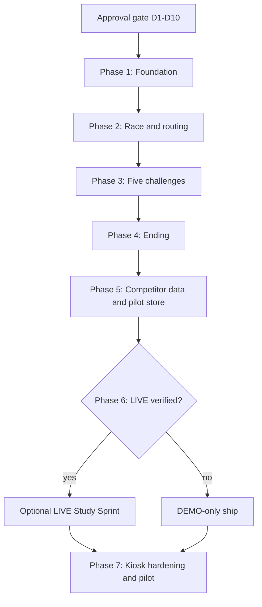

# Implementation Plan — AI PC Showdown (v3)

Status: Phases 1–4 implemented using the recommended defaults below. Pilot data, LIVE mode and kiosk hardening remain.

---

## 1. Purpose

This plan converts `CLAUDE.md` v3 and `docs/ARCHITECTURE.md` / `docs/GAME_DESIGN.md` into an ordered, testable delivery sequence. It follows the spec's seven development phases and preserves the rule: keep the MVP playable at every milestone.

---

## 2. Decision Defaults

These defaults were applied to Phases 1–4. Remaining decisions still require confirmation before their later phases.

| # | Decision needed | Recommended default | Blocks |
|---|---|---|---|
| D1 | Is the ending idle timeout 45 s or 60 s? | Landing 60 s; ending 45 s; any interaction resets | Phase 4 |
| D2 | How is Stream Night split for persona weights? | Emit optional `subscores.gamingRouting` and `subscores.multitaskingRouting` from Stream Night; keep total capped at 200 | Phase 3/4 |
| D3 | Is `priceDate` store-level or per model in the gate? | Store-level `priceDate` within 90 days + at least two in-stock models with `lastVerified` within 90 days | Phase 4 |
| D4 | Where do `illustrativeRoutingWeight` values live? | `challenges.json` owns packet semantics; `race.json` owns numeric tuning keyed by packet id; loader merges into effective packets | Phase 2 |
| D5 | What are default routes for skips and Battery Escape `none` packets? | Explicit config defaults; `low`/`high` benefit implies NPU compatible, `none` implies not NPU compatible; spreadsheet/browser CPU, video export GPU | Phase 2/3 |
| D6 | Where is the store PIN/config and how is `storeId` chosen? | Local kiosk config outside UI; `storeId` selects bundled `stores/{storeId}/inventory.json` | Phase 1/4 |
| D7 | What is the "staff-printable area"? | On-screen print-ready card view plus local image export; no upload | Phase 4 |
| D8 | Is LIVE mode required for pilot? | DEMO-only release unless target-unit execution device verification is complete | Phase 6 |
| D9 | Are pre-generated Creator before/after images and self-hosted fonts available? | If absent, use placeholder local assets clearly marked as demo content; replace before pilot | Phase 1/3 |
| D10 | Is verified pilot inventory and sourced competitor data available? | If absent, ship gate fallback with example inventory only; never invent data | Phase 4/5 |

---

## 3. Dependencies

The Phase 1 stack and Phase 2/3 game dependencies are installed. Remaining items below apply to later phases or target-unit verification.

| Dependency | Needed by | Action | Risk if missing |
|---|---|---|---|
| Node/npm toolchain, pinned versions | All phases | Choose and record versions in Phase 1 | Build drift on kiosk |
| Vite, React 18, TypeScript strict, Tailwind, Framer Motion, Zustand, React Router hash, Phaser 3 | Phase 1/2 | Install via package manifest in Phase 1 | Architecture cannot be realized |
| `vite-plugin-pwa` / Workbox | Phase 1 | Configure precache in Phase 1 | Offline cold boot fails |
| Self-hosted Inter and Space Grotesk | Phase 1 | Supply font files locally | Runtime font request or fallback typography |
| Pre-generated before/after images and animations/audio | Phase 3 | Supply before Creator Mode | Challenge cannot be built honestly |
| Local mode config (`DEMO`/`LIVE`) | Phase 1/6 | Define path/schema after D6/D8 | Mode ambiguity |
| Store inventory for pilot store | Phase 4/5 | Staff supplies `stores/{storeId}/inventory.json` | Gate fallback only |
| Competitor reference data with sources | Phase 5 | Research and verify three classes | Comparison panel fails review |
| Target demo unit and Chromium kiosk environment | Phase 7 | Provision for timing and offline tests | No valid 180 s or pilot sign-off |
| Staff PIN and store readiness process | Phase 4/7 | Decide after D6 | Staff panel cannot be secured |

---

## 4. Implementation Order

### Why this order

1. Pure logic and state contracts come before presentation so scores and race results cannot drift.
2. Race and fallback come before challenges so every challenge has a working destination for packets.
3. Challenges come before the ending because persona and recommendations consume challenge outputs.
4. Ending logic comes before pilot data so the fallback works even if verified inventory is late.
5. Competitor verification comes before pilot release because unsourced comparison fails review.
6. LIVE AI is optional and last because NPU claims require target-unit proof.
7. Kiosk hardening comes last because it depends on the full asset and route set for precache and timing.

---

## 5. Phase-by-Phase Plan

## Phase 0 — Spec decisions and doc baseline

**Goal:** remove ambiguity before code.

- Restate requirements from `CLAUDE.md`.
- Inspect workspace and confirm only `CLAUDE.md` existed.
- Create `docs/ARCHITECTURE.md`, `docs/GAME_DESIGN.md`, `docs/IMPLEMENTATION_PLAN.md`.
- Record technical risks, dependencies and open decisions.
- Wait for approval.

**Exit criteria:** this document set reviewed; D1–D10 answered or defaults accepted.

---

## Phase 1 — Foundation

**Goal:** polished landing screen that loads offline.

**Smallest complete units, in order:**

1. Scaffold Vite + React 18 + TypeScript strict.
2. Add Tailwind with design tokens from Section 14.
3. Add Framer Motion, Zustand, React Router hash, Lucide icons.
4. Establish `src/app/` shell with phase-driven routing and providers.
5. Define core types in `src/types/` for `GameState`, packet, challenge result and mode.
6. Add self-hosted fonts and base styles; no remote font/image URLs.
7. Build landing screen from Section 15 with one START action.
8. Add PWA shell and precache manifest baseline.
9. Add build-time offline check: fail on runtime `fetch` or external resource URL in source; allow citation URLs in JSON data.
10. Add config loader skeleton with schema validation for `challenges.json`, `race.json`, `personas.json`.

**Tests / verification:**

- Strict TypeScript build passes.
- Landing renders START and lane visuals.
- Offline check flags a deliberately injected runtime `fetch` in a test fixture, then passes after removal.
- Config validation rejects missing packet fields and duplicate ids.
- Network panel shows no external requests in dev preview.

**Docs to create/update:** `docs/TIMELINE.md` skeleton; `docs/KIOSK_DEPLOYMENT.md` build-check notes.

**Risks:** A4 offline gaps, A8 copy leakage, D6/D9 dependencies.

**Exit criteria:** landing works offline from static bundle; no implementation beyond foundation.

**Implementation status:** Vite/React 18/strict TS, Tailwind tokens, self-hosted fonts, Framer Motion, Zustand, hash routing, PWA shell, offline source check, local kiosk config, type shell and landing screen are implemented. Mini-games are implemented in Phase 3. The `challenges.json` / `race.json` / `personas.json` validation skeleton from item 10 was completed in Phases 2–4.

**Phase 1 verification:** `npm run check:offline` passed on 13 source files and failed as expected on an injected `fetch` probe. `npm run typecheck`, `npm run lint` and `npm run build` passed. The production build generated `sw.js` with 62 precache entries, including `index.html`, `manifest.webmanifest`, `favicon.svg` and bundled font files. A local preview server returned 200 for index, service worker and manifest. Headless Chrome rendered the built app at 1920 × 1080 and 1366 × 768 without console-level network failure in the final screenshot run; image inspection by this model is not supported, so visual sign-off still needs a human reviewer. Network-panel verification and the full kiosk cold-boot test remain in Phase 7.

---

## Phase 2 — Race and Routing

**Goal:** race running with placeholder packets, including fallback.

**Affected areas:** `src/game/race/`, `src/game/config/`, `src/game/events/`, `src/game/scenes/`, `src/store/`, `src/data/`.

**Smallest complete units, in order:**

1. Define effective packet assembly from `challenges.json` + `race.json` per D4.
2. Implement pure routing function: chosen engine → progress delta or fallback destination.
3. Implement pure fallback-delay application using config.
4. Implement race progress reducer for left/right lanes; deterministic for same inputs.
5. Add typed event contracts from `docs/ARCHITECTURE.md`.
6. Mount one Phaser game instance from React; add Boot, RaceSetup and RaceFinish scenes.
7. Build React race HUD: lanes, captions, timer, disclosure, skip.
8. Wire `packet:routed`, `packet:fallback`, `race:update`, `timer:tick`, `challenge:complete` into Zustand.
9. Add skip/timeout tie behavior and default routes per D5.
10. Enforce scene shutdown cleanup and single-instance lifecycle.
11. Add placeholder packets so fallback can be demonstrated without challenge scenes.

**Tests / verification:**

- Deterministic progress for identical inputs.
- Fallback routes to configured CPU/GPU and caption key.
- Fallback delay applied once.
- Skip produces tie and zero score.
- HUD shows exact required disclosure.
- No duplicate Phaser instance after repeated mount/unmount.
- Timers/listeners removed on scene exit.

**Docs to create/update:** `docs/ARCHITECTURE.md` event contract refinements; `docs/TIMELINE.md` setup/finish timing.

**Risks:** A1 lifecycle, A2 timeline, A3 logic drift, D4/D5.

**Exit criteria:** race segment runs with placeholder packets, visible fallback, HUD and disclosure.

**Implementation status:** complete. Effective packets are assembled by `src/game/config/loadConfig.ts`; routing, fallback delay and deterministic left/right progress are pure functions in `src/game/race/routing.ts`; the typed bus, single Phaser mount, React HUD, timeline controller and event reduction are wired. `tests/race.test.ts`, `tests/bus.test.ts` and `tests/store.test.ts` cover deterministic progress, fallback, skip tie, score cap, timeout best-result and reset cleanup.

**Phase 2 verification:** `npm run typecheck`, `npm run lint`, `npm run test`, `npm run check:offline` and `npm run build` pass. On-unit timing, network-panel inspection and duplicate-instance tests remain for Phase 7.

---

## Phase 3 — Challenges

**Goal:** five playable challenges feeding the race, built and tested one at a time.

**Affected areas:** `src/game/scenes/`, `src/game/scoring/`, `src/data/challenges.json`, local media, event contracts.

**Build order:** Study Sprint → Creator Mode → Privacy Shield → Stream Night → Battery Escape.

### 3.1 Study Sprint

- Pure scorer: correct concepts minus incorrect, 15 s time bonus only when correct, clamp 0..200.
- Scene: lecture note, nine-item pool, five-slot tray, touch drag.
- Caption: demo summary labelled "Demo content".
- Packet: Notes summary, NPU compatible with app-support caption.
- Tests: bounds, distractor penalty, timeout best-result, skip.

### 3.2 Creator Mode

- Pure scorer: sequence accuracy + packet routing score, clamp 0..200.
- Scene: before-image, tap sequence, pre-generated before/after transitions.
- Packets: background removal NPU compatible/low benefit; style filter non-NPU/GPU suitable.
- Assets: local pre-generated images only; no live-inference claim in DEMO.
- Tests: correct/incorrect sequence, style filter fallback if routed to NPU, asset presence.

### 3.3 Privacy Shield

- Pure scorer: local route choice + app-settings leak bonus, clamp 0..200.
- Scene: contract, local/cloud routes, padlock on local route.
- Required result line shown exactly.
- Tests: local route scores, cloud route fails right lane, required copy present, no "NPU guarantees privacy" copy.

### 3.4 Stream Night

- Pure scorer: illustrative frame stability + routing for GAME/STREAM/CALL blur, clamp 0..200.
- Scene: three simultaneous packets dragged to CPU/GPU/NPU; illustrative meter.
- GAME to NPU falls back to GPU with caption.
- Subscores per D2 for persona.
- Tests: game stays GPU for correct route, NPU game fallback, no FPS/latency copy, subscores emitted.

### 3.5 Battery Escape

- Pure scorer: remaining simulated battery + correct routing, clamp 0..200.
- Scene: five packets, illustrative meter, drain from config.
- `none` benefit packet routed to NPU changes nothing and caption says so.
- Packet defaults per D5.
- Tests: no change for `none`, slower drain for `low`/`high`, GPU export stays GPU, meter labelled illustrative, no hours/minutes/percentage improvement.

**Cross-cutting verification:**

- Each challenge completes, skips and times out within 25 s.
- All challenge scores capped at 200.
- Timers/listeners cleaned up on exit.
- Required educational messages and disclosure appear.
- Banned-string check for FPS, benchmark, speedup, battery-life figures and "efficiency" race wording.

**Docs to create/update:** `docs/GAME_DESIGN.md` implementation confirmations; `docs/TIMELINE.md` per-challenge timing measurements.

**Risks:** A1/A2 lifecycle and timing, A3 scoring drift, A8 copy, D2/D5/D9.

**Exit criteria:** five interactive challenges feed the race; each capped, skippable and timed out correctly.

**Implementation status:** complete in build order. Study Sprint, Creator Mode, Privacy Shield, Stream Night and Battery Escape each have a pure scorer, a Phaser scene and dedicated tests. Tests also confirm local demo images exist, required Privacy Shield copy is exact, Stream Night emits persona subscores and contains no FPS/frame-time/latency copy, and Battery Escape uses no-change and illustrative-only copy.

**Phase 3 verification:** 36 unit tests pass; `npm run typecheck`, `npm run lint`, `npm run check:offline` and `npm run build` pass. Manual challenge completion, skip and timeout observation on the target unit remain for Phase 7.

---

## Phase 4 — Ending

**Goal:** full session ending in a real in-stock recommendation or documented fallback.

**Affected areas:** `features/recommendations/`, `features/store-readiness/`, `features/store-picks/`, `features/value-compare/`, `features/fit-panel/`, `features/persona-card/`, `features/handoff/`, `features/staff-panel/`, `src/services/`, React screens.

**Smallest complete units, in order:**

1. Pure persona engine using D2 subscores; weighted calculation, tie-breaks, skip-heavy note.
2. Pure readiness gate using D3 interpretation; pass/fail reasons for staff.
3. Pure model ranking: top/value/alternative from in-stock models only; null-safe, deterministic.
4. Pure value comparison: top vs cheapest in-stock; plain rows; no score/percentage/winner.
5. Pure fit-panel row builder: verified proof or "Ask our team"; source on every verified row.
6. Inventory and competitor services loading bundled local JSON; no runtime fetch.
7. Persona reveal screen with three priorities, race result and disclosure.
8. Store picks screen and fallback path.
9. Value + fit screen with shopper checklist.
10. Next-step bar: Ask a specialist, Save your picks, Play again.
11. Handoff storage: store id, persona, model code, timestamp; cleanup at 24 h/confirmation.
12. Staff panel: 3 s corner long press, PIN, handoffs, inventory status, gate result/warning, mode, reset, Exit kiosk.
13. QR payload generator and local persona card render/export per D7.
14. Idle/reset handlers per D1; restart clears session state but preserves handoffs.
15. Anonymous daily totals for measurement metrics.

**Tests / verification:**

- Persona table cases including ties and skip-heavy sessions.
- Gate: two verified in-stock models pass; one fails and shows fallback.
- Only in-stock models recommended.
- Correct top and cheapest selected; dedupe top/value/alternative when models overlap.
- Fit panel uses "Ask our team" for unverified values.
- Price/value panel has no score, percentage or winner.
- Handoff contains no personal data; cleanup works.
- QR payload has no session id; card has no shopper identifier.
- Restart clears session fields, not handoffs.
- Staff PIN and Exit kiosk work.
- Idle timing per D1.

**Docs to update:** existing architecture, game-design, implementation-plan and kiosk docs; keep product-data and measurement notes in existing docs unless new files are explicitly requested.

**Risks:** A5 data availability, A6 clock/date, A9 sparse ranking, A10 staff gesture, D1/D3/D6/D7.

**Exit criteria:** complete session ends with ranked in-stock models or fallback; handoff, card, QR and staff panel work locally.

**Implementation status:** complete using D1/D3/D6/D7/D10. Persona, scoring summary, readiness gate, model ranking, value comparison, fit rows and QR payload are pure and tested. Ending screens navigate automatically through store picks, value/fit and next-step using absolute 165 s and 175 s deadlines. Handoff records contain only store id, persona, model code and timestamp; local QR and persona-card export make no upload. Staff panel uses a 3-second corner long press and now opens as an overlay so challenge scenes and timers keep running. Anonymous daily totals are stored locally with one completion and one action per session.

**Audit fixes applied:** 180-second stop now finalizes and finishes directly at next-step; ending routes require an active session; repeated handoffs are blocked; idle reset clears session state; stale handoffs are cleaned at app boot; QR persona codes match the spec example; race finish has three winner states; Creator Mode reset clears packet routes; zero-score sessions get no achievement; Study Sprint uses nine concepts with two distractors; NPU class display and ranking require an Intel specification source; competitor panels include memory, storage, battery and persona app-support rows; offline checks include banned-claim scanning.

**Data status:** `stores/LFR01/inventory.json` contains in-stock models and prices collected from Reliance Digital, Croma and Vijay Sales on 27 Nov 2026. One Acer model has no published price and displays "Not shown". Competing store folders remain placeholders. Competitor class data is local and sourced, with honest "check the exact configuration" facts where class pages do not publish exact memory, storage or Wh values.

**Phase 4 verification:** 51 unit tests pass; `npm run typecheck`, `npm run lint`, `npm run check:offline` and `npm run build` pass. Manual full-session timing, staff gesture and QR scan observation on the target unit remain for Phase 7.

---

## Phase 5 — Competitor Data and Pilot Store

**Goal:** sourced comparison and verified pilot data.

**Affected areas:** `data/competitors.json`, `stores/{storeId}/inventory.json`, comparison panel, content checks.

**Smallest complete units, in order:**

1. Research and verify processor model names and NPU classes for pilot models.
2. Enter staff-sourced inventory into `stores/{storeId}/inventory.json`; null all unverified fields.
3. Create competitor classes: AMD Ryzen AI, Qualcomm Snapdragon X, Apple M-series.
4. For each: NPU note with source, at least one honest strength with source, honest Intel strengths, `lastVerified`.
5. Wire comparison panel rows and class switcher; default AMD Ryzen AI.
6. Add "Check independent reviews before you buy." fallback where no cited test exists.
7. Verify Section 12.4 items: model names/NPU classes, TOPS handling, frameworks/runtimes, on-device features on store unit.
8. Run gate with real pilot data; confirm staff warning before fallback.

**Tests / verification:**

- Every product field cited, staff-entered or null.
- Every competitor class has at least one strength with source.
- No competitor claimed to lack AI capability if it has NPU/accelerator.
- No unsourced benchmark, battery-life, performance or speedup claim.
- Gate passes with at least two verified in-stock models or fallback is explicitly accepted.

**Docs to create/update:** `docs/PRODUCT_DATA.md`, `docs/MEASUREMENT.md` gate uptime setup.

**Risks:** A5, A6, D10.

**Exit criteria:** sourced comparison and verified pilot data, or documented fallback-only pilot decision.

---

## Phase 6 — Advanced AI (optional)

**Goal:** one verified live demonstration, or DEMO-only ship.

**Affected areas:** `src/services/ai/`, mode config, Study Sprint scene, labels, `docs/AI_INTEGRATION.md`.

**Smallest complete units, in order:**

1. Define `AIService` interface and DEMO adapter behavior.
2. Investigate Intel AI Playground and OpenVINO on the target unit.
3. Verify execution device through the inference runtime; record the report.
4. If verified: implement LIVE for Study Sprint summarisation only.
5. Show "Generated live on this device" plus reported engine.
6. If LIVE fails or device is unverified: fall back to DEMO for that challenge and show "Showing demo content."
7. Confirm no browser API is treated as automatic NPU proof.

**Tests / verification:**

- DEMO is default and fully offline.
- LIVE failure does not break gameplay.
- No NPU claim without recorded execution-device report.
- Labels switch correctly.

**Docs to create/update:** `docs/AI_INTEGRATION.md`.

**Risks:** A7, D8.

**Exit criteria:** one verified LIVE challenge or explicit DEMO-only release.

---

## Phase 7 — Kiosk Hardening and Pilot

**Goal:** stable, offline-capable pilot with measurement.

**Affected areas:** PWA config, kiosk launch scripts, idle/reset, staff panel, build checks, timing tests.

**Smallest complete units, in order:**

1. Full offline build check; audit precache against all routes/assets/JSON.
2. Cold-boot test with network disabled.
3. Chromium kiosk launch fullscreen, no address bar/tabs/browser UI.
4. Auto-start on boot and restart on crash.
5. Verify 1920 × 1080 and 1366 × 768.
6. Touch-only operation and 64 px targets.
7. Idle reset behavior per D1.
8. Staff panel PIN, gate warning, mode display, reset and Exit kiosk.
9. Run 20 timed sessions with different users; confirm ≤180 s guided segment.
10. Check no console errors, unhandled rejections, broken assets or duplicate Phaser instances.
11. Enable anonymous daily totals on staff panel; record week-1 baselines.
12. Final content review against Section 21 Definition of Done.

**Tests / verification:** all gameplay, timing, technical, kiosk, content and measurement scenarios in `docs/GAME_DESIGN.md` Section 10.

**Docs to create/update:** `docs/KIOSK_DEPLOYMENT.md`, `docs/TIMELINE.md`, `docs/MEASUREMENT.md`.

**Risks:** A2, A4, A5, A6, A10.

**Exit criteria:** stable offline pilot; baselines recorded; Definition of Done satisfied.

---

## 6. Risk Register

| ID | Risk | Phase | Trigger | Impact | Mitigation |
|---|---|---|---|---|---|
| R1 | 180 s overrun | 2/3/7 | Slow scene boot or long transitions | Guided session exceeds budget | Absolute timeline targets, auto-advance on cap/skip, 20 timed runs |
| R2 | React/Phaser lifecycle leak | 2/3 | Restart or scene exit | Duplicate games, stale listeners | Single mount, typed bus, shutdown cleanup tests |
| R3 | Pure logic drift | 2/3/4 | UI recalculates scores | Non-deterministic results | Pure modules own derivation; unit tests; no UI imports |
| R4 | Offline asset miss | 1/7 | New asset not precached | Broken kiosk offline | Precache audit, build scanner, cold-boot network-off test |
| R5 | Unverified pilot data | 4/5 | Staff data or sources absent | Invalid recommendations | Gate fallback; null fields; no invented values |
| R6 | Kiosk date wrong | 4/7 | Clock misconfigured | Gate falsely fails/passes | Staff gate reason, date validation, D3 decision |
| R7 | NPU/AI overclaim | 6 | LIVE device unverified | Misleading claim | DEMO default, recorded device report, LIVE fallback |
| R8 | Copy guardrail breach | 1/3/5 | Benchmark/battery/efficiency wording | Spec violation | Central copy constants, banned-string check, content review |
| R9 | Sparse ranking ambiguity | 4 | Null product fields | Arbitrary model order | Null-safe comparator, deterministic tie-breaks, "Ask our team" |
| R10 | Staff gesture conflict | 4/7 | Long press during challenge | Input errors | Corner-only deliberate 3 s hold; confirm availability window |
| R11 | Dependency/tooling mismatch | 1/7 | Unpinned versions on unit | Build or runtime drift | Pin versions; verify on target unit early |

---

## 7. Verification Strategy

| Level | Method | Owner timing |
|---|---|---|
| Unit | Pure race, scoring, persona, gate, ranking, comparison, fit functions | Every phase as code is added |
| Integration | Event bus → Zustand → React; Phaser lifecycle; service loaders | Phases 2–4 |
| Build | Strict TypeScript, offline scanner, PWA precache audit | Phase 1 onward; final in Phase 7 |
| Manual gameplay | Each challenge completed/skipped/timed out; fallback captions | Phase 3 |
| Content | Source/citation review; banned-claim scan | Phase 4 audit onward; final in Phase 7 |
| Kiosk | Cold boot offline, resolutions, touch, staff panel, idle | Phase 7 |
| Timing | 20 guided runs on demo unit | Phase 7 |

---

## 8. Definition of Done Mapping

| Spec DoD item | Delivered in |
|---|---|
| 1. Start immediately, no login | Phase 1 |
| 2. Guided session ≤180 s on demo unit | Phase 7 |
| 3. Five playable challenges, 25 s caps | Phase 3 |
| 4. All five interactive | Phase 3 |
| 5. Race with fallback | Phase 2/3 |
| 6. Stream Night GPU gaming honesty | Phase 3 |
| 7. CPU/GPU/NPU roles accurate; NPU not universal | Phase 2/3 |
| 8. Privacy is app/settings matter | Phase 3 |
| 9. Illustrative labels; no fabricated numbers | Phase 2/3/5 |
| 10. Weighted persona | Phase 4 |
| 11. In-stock recommendations or fallback | Phase 4/5 |
| 12. Value + fit with verified facts | Phase 4/5 |
| 13. Checklist and sourced competitor comparison | Phase 4/5 |
| 14. Staff handoff and persona card, no personal data | Phase 4 |
| 15. Offline fullscreen kiosk with idle reset and staff exit | Phase 1/7 |
| 16. Pilot measurement with week-1 baselines | Phase 4/7 |

---

## 9. Approval Statement

Phases 1–4 were implemented using D1–D7, D9 and D10 above. Remaining defaults require review before later phases: D8 LIVE scope and pilot-store verification in Phase 5.
